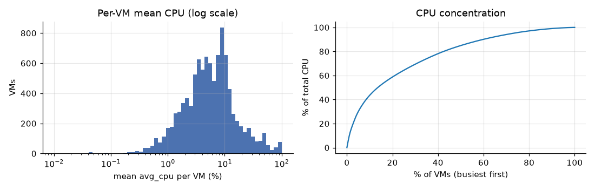
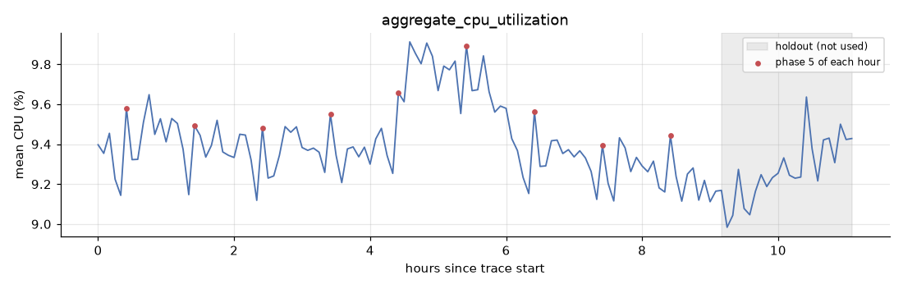
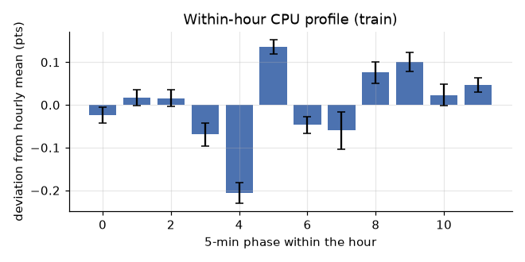
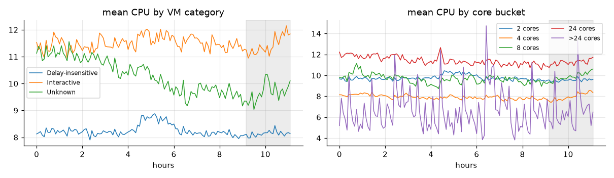
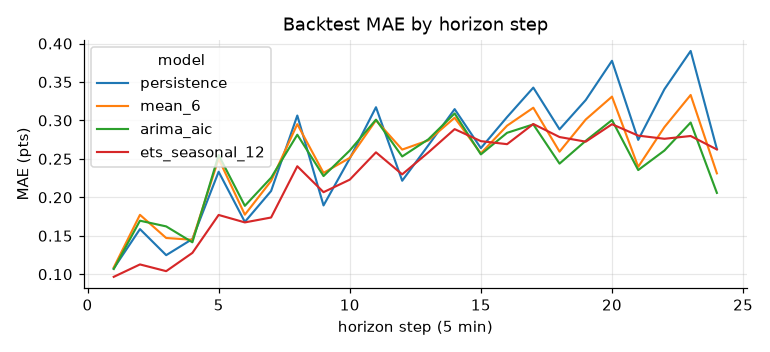
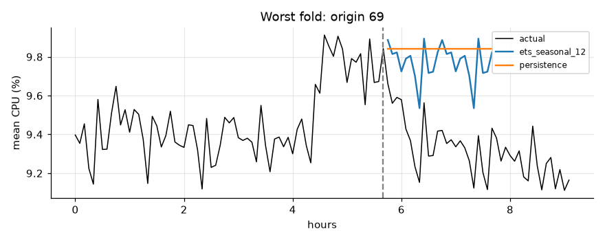

# Cloud Workload Forecasting — Final Report

Data: `data-v1` (10,000 Azure VMs × 134 five-minute readings). Code, notebooks and tests are in this repository. Every number below can be regenerated with `python -m cwfc.predict` and the three notebooks.

## 1. Executive summary

- **`active_vm_count` is a constant 10,000.** Every selected VM reports at every timestamp, because the curated sample only admitted VMs with a complete trace. Persistence is exact for this target, and that is the forecast we submit. On this sample, the count says nothing about real fleet churn.
- **`aggregate_cpu_utilization` is very stable and fairly predictable.** It stays between 8.98% and 9.91% (std 0.19 pts). On top of a slowly wandering level it has a clear **hourly cycle**: a dip followed by a jump at a fixed 5-minute phase each hour, which looks like scheduled jobs.
- **A seasonal exponential smoothing model (ETS, additive level + 12-step season) is the chosen model.** In a 13-origin rolling backtest inside the training window it beats persistence by **12% on MAE** (0.227 vs 0.258 pts) and 10% on RMSE. On the untouched 2-hour holdout, scored once, it beats persistence by **4.6% on MAE** (0.140 vs 0.147) and 4.8% on RMSE. The gain is real but small, and the main reason the model works is the hourly cycle.
- **Recommendation:** every 15 minutes, provision for the next 2 hours at one flat level equal to the **highest p95 band value in that window**. In backtest this removed every under-provisioning event for about 0.7 pts of mean headroom (~200 vCPUs on a 28k-vCPU fleet). On the holdout it also had no breaches. Pre-schedule capacity for the hourly spike instead of reacting to it.

## 2. Data understanding and preprocessing

All checks are in `cwfc.io.check_data` and `notebooks/01_data_understanding.ipynb`.

| Check | Result |
|---|---|
| Rows / VMs / timestamps | 1,340,000 / 10,000 / 134 |
| Cadence | every gap is exactly 300 s (0 → 39,900 s, 11.1 h) |
| Duplicate `(timestamp, vm_id)` | 0 |
| Missing values | 0 in every column |
| CPU outside [0, 100] | 0; `min ≤ avg ≤ max` holds on every row |
| VMs per timestamp | 10,000 at every timestamp |
| Readings ↔ metadata | identical VM sets, one metadata row per VM |

**Shared timestamps.** All VMs cover the same 134 timestamps, so the window has no churn. The metadata shows every VM already existed when the trace started, and 82% were still alive at the end of the 30-day trace. The earliest deletion comes 10 minutes after the last reading. Deletion timestamps are future information, so we use them only to describe the sample and never as a feature.

**Target construction** (`cwfc.targets.build_targets`) is done on the full series first, and the split happens afterwards:

- `active_vm_count(t)` is the number of distinct VMs with a finite `avg_cpu` at `t`. Duplicate rows for a VM collapse to one before counting.
- `aggregate_cpu_utilization(t)` is the mean over those VMs of their `avg_cpu`. Duplicates are averaged per VM first so no VM gets double weight, and values are clipped to [0, 100].
- **Missing readings:** the mean is taken over the VMs present at `t`, with no per-VM imputation. The target is defined over the population observed at that timestamp, and filling in a VM's CPU would invent data.
- **Timestamp gaps:** the series is reindexed to a regular grid at the inferred cadence. Empty slots are linearly interpolated and flagged `imputed`. This release has no gaps, so none of this changes the data, but the pipeline doesn't assume that, and the tests cover it.

Each target value uses only readings from its own timestamp, so building the series before splitting cannot leak across time. The first 110 points form the training window and the last 24 are the holdout. Both sizes are derived from the data and the `--horizon` setting, not hard-coded.

## 3. Workload analysis

(`notebooks/02_eda_workload.ipynb`. Statistics that inform modelling use the training window only.)

**Utilisation is low and very skewed.** The median VM averages 5.5% CPU, 46% of VMs stay under 5%, and the p99 VM averages 78%. The busiest 10% of VMs produce 44% of all CPU. *Operationally:* most of the fleet is over-sized for its load, and aggregate demand depends on a few hundred heavy VMs. Right-sizing the long tail is a bigger lever than forecasting accuracy.

**The aggregate is far smoother than any single VM.** The median per-VM standard deviation is 1.35 pts and the median per-VM lag-1 autocorrelation is just 0.07, so individual VMs are close to noise at 5-minute resolution. The 10,000-VM mean has a standard deviation of 0.19 pts. *Operationally:* forecast at the pool level. Per-VM 5-minute forecasts would be mostly noise.

**There is an hourly cycle, and no longer cycle can be seen.** The ACF of the differenced training series is 0.61 at lag 12 and 0.58 at lag 24. The within-hour profile has a dip of −0.21 pts at phase 4 followed by a jump of +0.14 pts at phase 5, every hour. About 100 VMs produce 80% of the jump. The cycle is strongest in delay-insensitive VMs, which points to scheduled batch work. With 11 hours of data, daily and weekly seasonality cannot be estimated, so we use no hour-of-day or weekday features. The within-hour phase is known in advance at any origin, so using it involves no leakage. *Operationally:* the spike is predictable, so capacity for it can be scheduled. Staggering those ~100 VMs' jobs would flatten it.

**Segments differ in level and stability.** Interactive VMs average 11.5% CPU, delay-insensitive VMs 8.2%, and `Unknown` VMs 10.2%. `Unknown` is the most volatile category and falls from about 11% to 9–10% across the window. The `>24`-core bucket has only 10 VMs, so its statistics are noise.

**Peaks and lows.** The largest excursion in the training window is a block of about 1.5 hours (hours 4.4–6) in which the aggregate rises by ~0.5 pts. 0.31 pts of that rise comes from delay-insensitive VMs, about 80% of the total. The series peaks at 9.91% (hour 4.6) and bottoms at 8.98% (hour 9.25, inside the holdout). The peak is only 5.6% above the mean. Measured in cores, the fleet keeps about 2,520–2,750 of its ~28,400 allocated vCPUs busy (`>24` counted as 32 cores). *Operationally:* there is no overload risk in this window. The risk that matters is batch blocks starting or ending without warning.

## 4. Forecasting approach

The constraints shaped the model choice: 110 training points, one regular cycle (hourly), no calendar effects that can be validated, and a 24-step horizon. Under those conditions, simple, well-tested models usually win. All candidates share one `fit(y) / predict(h)` interface (`cwfc.baselines`, `cwfc.models`) and run through identical backtests:

| Model | Idea |
|---|---|
| `persistence` | last value |
| `mean_6`, `mean_12` | mean of last 30 / 60 min |
| `drift` | line from first to last point |
| `seasonal_naive_12` | value one hour earlier |
| `level_season_12` | last-hour mean + average within-hour profile |
| `holt_damped` | ETS with damped trend |
| `ets_seasonal_12` | ETS, additive level + additive 12-step season |
| `arima_aic` | ARIMA(p≤2, d≤1, q≤2), order picked by AIC **inside each fold** |
| `ridge_direct` | one ridge model over all horizons. Features are computed from data up to the origin only: 6 lags, 30/60-min means and stds, 60-min slope, the same-phase value one hour earlier, the target's within-hour phase, and the horizon step. It predicts the gap from the last-hour level. |

Seasonal-naive is included because the ACF justifies a 12-step season. A daily seasonal-naive is not possible because no full day is observed. Every model falls back to persistence when a series is too short or flat, so the pipeline also runs on tiny smoke datasets.

On the full training window, the chosen ETS settles on a fast-moving level (α = 0.69) and a fixed seasonal profile (γ = 0): the level wanders, but the shape of each hour stays put. That matches the EDA.

## 5. Validation methodology

- **Rolling origin with an expanding window, training data only.** Origins start at t = 48 (4 hours of history) and move forward 3 steps (15 min) at a time. Each origin forecasts the next 24 steps, the same horizon as the real task. With 110 training points that gives 13 origins (48, 51, …, 84). Every model, baselines included, uses the same origins. `backtest_plan` derives all of this from the data and shrinks it automatically on short series.
- **Why this matches production:** a capacity planner re-forecasts the next 2 hours every few minutes using only the past. Each fold does the same.
- **Selection:** lowest mean fold MASE for each target, with ties going to the simpler model. We check that the winner also leads on MAE and RMSE.
- **Holdout protocol:** the final 24 points are never used in fitting, feature construction, tuning or selection. `predict.py` writes `predictions.csv` first and only then scores the holdout, for reporting. Two tests enforce this. `test_no_leakage.py` checks that features and backtest forecasts don't change when later data is replaced with garbage. `test_holdout_readings_do_not_change_predictions` corrupts the holdout readings, and even drops a VM, then checks that the predictions come out identical.

Caveat: origins are 15 minutes apart with a 2-hour horizon, so neighbouring folds overlap heavily. The 13 folds are not 13 independent tests, and small differences between models should be read with that in mind.

## 6. Results versus baseline

**Backtest, `aggregate_cpu_utilization`** (13 origins × 24 steps, in pts. Peak MAE covers timestamps whose actual value is in the top 20% of the training window, above 9.55%):

| Model | MAE | RMSE | MASE | Peak MAE | Worst fold MAE | MAE vs persistence |
|---|---:|---:|---:|---:|---:|---:|
| **ets_seasonal_12** | **0.227** | **0.282** | **1.82** | 0.243 | 0.401 | **+12.0%** |
| arima_aic | 0.242 | 0.296 | 1.94 | 0.272 | 0.392 | +6.1% |
| mean_6 | 0.250 | 0.300 | 2.00 | 0.251 | 0.372 | +3.0% |
| persistence | 0.258 | 0.315 | 2.06 | **0.206** | 0.474 | — |
| ridge_direct | 0.259 | 0.316 | 2.07 | 0.292 | 0.532 | −0.7% |
| level_season_12 | 0.268 | 0.306 | 2.15 | 0.265 | 0.400 | −4.1% |
| mean_12 | 0.270 | 0.313 | 2.16 | 0.267 | 0.400 | −4.9% |
| holt_damped | 0.276 | 0.337 | 2.21 | 0.258 | 0.454 | −7.1% |
| seasonal_naive_12 | 0.286 | 0.333 | 2.29 | 0.305 | 0.400 | −11.0% |
| drift | 0.297 | 0.370 | 2.37 | 0.228 | 0.559 | −15.2% |

MASE divides each fold's MAE by the in-sample MAE of the one-step naive forecast on that fold's training data. This avoids the near-zero denominators that make percentage errors unstable, though no target value here is near zero anyway. MASE is above 1 for every model because 24-step errors are being scaled by a 1-step error. The ranking is what matters.

**`active_vm_count`:** every model has zero error, and persistence is chosen by the simplicity tie-break. MASE has a zero denominator here and is defined as 0 when the error is also 0.

**Holdout (24 points, scored once):**

| Target | Model | MAE | RMSE | Persistence MAE | Persistence RMSE |
|---|---|---:|---:|---:|---:|
| aggregate_cpu_utilization | ets_seasonal_12 | **0.140** | **0.176** | 0.147 | 0.185 |
| active_vm_count | persistence | 0 | 0 | 0 | 0 |

The ranking from the backtest holds, but the margin shrinks from 12% to 5%. The holdout is calmer than the training window: only 1 of 24 points crosses the peak threshold, and persistence's holdout MAE (0.147) is far below its backtest MAE (0.258). A calm window favours persistence.

Some findings run against the model:
- **Persistence has the best peak MAE.** The fitted models smooth toward the level and under-call the high points. That is why the capacity policy in §8 is built on an upper band, not the point forecast.
- **ML did not help.** The direct ridge on lag and rolling features was no better than persistence. With ~110 points and heavily overlapping training rows there isn't enough signal for it. Damped Holt was worse than persistence too: it extrapolates short swings as trends.

## 7. Error and failure analysis

**Horizon decay.** ETS error rises from 0.10 pts at 5 minutes to about 0.27 by the end of the first hour, then stays flat. The series reverts to a level instead of trending away, so the second hour costs little extra accuracy. ETS has the lowest error at nearly every step up to about 75 minutes. After that, ETS, ARIMA and the 30-minute mean are close. The baselines' saw-tooth comes from the hourly spike landing on different steps in different folds.

**Worst folds.** These are origins 66–69 (ETS fold MAE 0.35–0.40; persistence 0.46–0.47). They start while the series is still inside the hours 4.4–6 batch block and have to forecast its end at hour 6. Nothing in the aggregate history signals that the block is about to finish, so every univariate model carries the high level forward and overshoots. Fixing this would take outside information, such as job schedules or per-segment leading indicators, not a different curve fit.

**Late-horizon bias.** In the backtest, residuals at long horizons skew negative (step-24 errors: p10 = −0.49, p90 = +0.05), meaning forecasts ran high. That is the same batch-block ending showing up in the late folds. On the holdout it appears as the forecast sitting slightly below the actuals in the last hour instead. With this little data, the bias direction depends on the window, which is one more reason to re-estimate the bands continuously in production.

**What wasn't predictable:** when batch blocks start and end, single-step spikes beyond the regular hourly one (e.g. hour 10.4 in the holdout, which was larger than the usual phase-5 jump), and VM churn, which this sample cannot show.

## 8. Capacity-planning recommendation

Uncertainty bands come from backtest errors (`cwfc.intervals`): for each horizon step we take quantiles of `actual − forecast`, pooled over ±2 neighbouring steps (~65 errors per step), and add them to the point forecast. We compared three rules on the backtest folds. All quantiles came from the backtest. The holdout was then used to score the chosen rule once, without changing it.

| Rule (aggregate CPU) | Backtest: timestamps breached | Backtest: 2-h windows with any breach | Backtest: mean headroom | Holdout: breached | Holdout: mean headroom |
|---|---:|---:|---:|---:|---:|
| Per-step p95 band | 6.1% | 23% | 0.47 pts | 3 / 24 | 0.26 pts |
| Persistence + static p95 margin | 5.1% | 15% | 0.51 pts | 1 / 24 | 0.24 pts |
| **Flat block at max p95 over the window** | **0%** | **0%** | 0.70 pts | **0 / 24** | 0.46 pts |

**Policy.**
1. Every 15 minutes, refit the seasonal ETS on the trailing data and forecast the next 2 hours.
2. Provision the pool for those 2 hours at a **flat level equal to the highest p95 band value in the window**. A per-step band gives each 5-minute slot its own 5% breach chance, so almost a quarter of 2-hour windows would see at least one shortfall. One level per window also avoids scaling up and down every 5 minutes.
3. Raise capacity **before** the known phase-5 spike each hour. It is scheduled, so there is no reason to wait for autoscaling to react.
4. **Peak-risk trigger:** if the block level rises more than 0.5 pts above the current level (about the size of the batch block we observed), alert and pre-warm capacity for delay-insensitive workloads. That is where the unpredicted shifts came from.

**Trade-off.** Under-provisioning costs throttling, queueing and SLA breaches, and it shows up exactly at peaks, which is where the point forecast is weakest. Over-provisioning costs idle capacity. With ~28,400 allocated vCPUs, one point of mean CPU is roughly 284 vCPUs (this assumes utilisation is independent of VM size; the core-weighted mean is within 0.1 pt of the unweighted one). The block rule's extra 0.22 pts of headroom over the per-step band costs about 60 vCPUs, around 2% of the ~2,640 busy vCPUs, and in backtest it removed every breach. For interactive or SLA-bound pools that is cheap insurance. For delay-insensitive pools, which tolerate a little queueing by design, the static-margin rule is a reasonable lower-cost option.

Caveat: backtest coverage is in-sample, since the quantiles were estimated on the same folds. On the holdout the per-step band covered only 87.5% against a nominal 95%. The bands should be re-estimated continuously as data accumulates, and their coverage monitored, before anyone relies on the exact percentile.

## 9. Limitations and future work

- **Short history.** 11 hours rules out daily and weekly seasonality, which in the full Azure trace are the dominant patterns. With the full 30-day trace, the first step would be a daily seasonal model and hour-of-day features.
- **The sample hides churn.** Only VMs with complete traces were selected, so `active_vm_count` is constant. A real fleet's count would need a model of arrivals and departures, for example using creation and deletion events as they happen.
- **Few, overlapping folds.** 13 origins with 21 of 24 steps shared between neighbours give noisy comparisons. The 5–12% gain over persistence is consistent across both evaluations but should not be over-read.
- **Unpredictable batch blocks.** These drove the worst errors. Segment-level forecasting (delay-insensitive vs interactive) combined bottom-up, or schedule data, is the most promising next step.
- **Interval calibration.** Use a proper conformal procedure with a rolling calibration window once more history exists.
- **Core-weighted demand.** The required target is an unweighted mean. For provisioning, a core-weighted target (busy vCPUs) maps more directly to capacity and would be worth forecasting alongside it.
